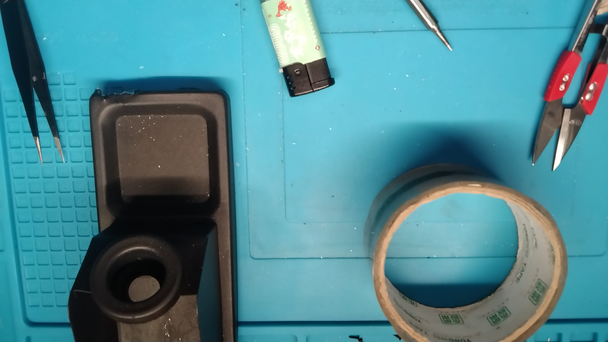
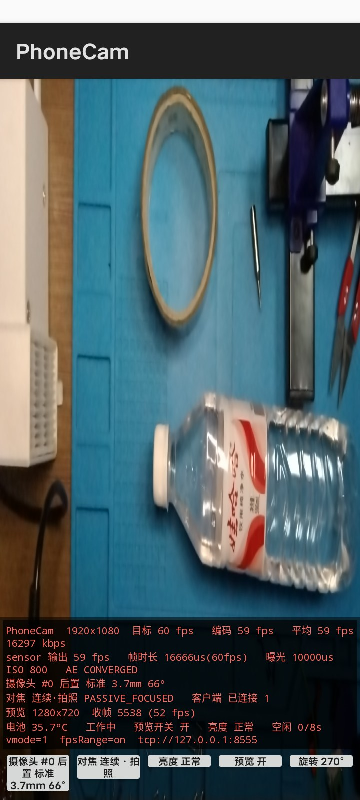

# PhoneCam

把安卓手机变成 OBS 的 1080p60 USB 视频源。

[](https://space.bilibili.com/2250922)

```
手机相机 (Camera2) → H.264 硬件编码 → MPEG-TS → USB (adb forward) → OBS 媒体源
```

**实测 1920×1080 @ 60 fps / ~16 Mbps**。全程数据线传输不走 WiFi，插线到 OBS 出画面约 10 秒，全自动。

不依赖 DroidCam / IP Webcam / Larix 这些。手机端 app 是自己写的：两个 Java 文件 + 一个 200 行的 MPEG-TS 复用器，无 Gradle、无依赖，APK 只有 ~37KB。

| OBS 里的画面（1080p60 实拍输出） | 手机端全屏取景界面 |
|---|---|
|  |  |

## 为什么自己造

把手机当 OBS 摄像头的需求很老，但现成方案都不行：

| 方案 | 问题 |
|---|---|
| DroidCam | 免费版锁 640×480，老协议延迟高 |
| IP Webcam | MJPEG 无压缩，1080p 下单帧 1.4MB，只有 ~13fps；OBS 浏览器源还周期黑闪 |
| Larix Broadcaster | 官方文档自己承认多数机型不给第三方 app 开 60fps |
| 任何走标准 Camera2 API 的 app | `CONTROL_AE_TARGET_FPS_RANGE` 普通模式 1080p 封顶 30fps |

根子在：**Android 标准 API 在 1080p 下拿不到 60fps**。这项目用高通私有 vendor tag 打开了隐藏的 HFR（高帧率）通道，这是能稳定 1080p60 的关键。

## 1080p60 是怎么打开的

### 标准 API 为什么不行

手机上跑 `dumpsys media.camera`，三条证据（这方法对**任何机型**都通用）：

```
android.control.preview-fps-range-values: … (30000,30000)      ← 普通模式 1080p 封顶 30fps
android.control.availableHighSpeedVideoConfigurations: 720p…   ← 标准高速模式不含 1080p
android.scaler.availableMinFrameDurations: 1080p → 33333333ns  ← 33ms/帧 = 30fps
```

### 私有表里藏着 1080p60

同一个 dump 里有张高通私有表 `org.quic.camera2.customhfrfps.info.CustomHFRFpsTable`（int32[48]），48 个数字按三元组 `(宽, 高, 最大fps)` 还原后：

```
1640×720@60   1600×900@60   1920×1080@60 ←   1440×1080@60   1280×960@60 …
```

**传感器本身支持 1080p60，只是不暴露给标准 API。** 调用方式（Java，不用 NDK）：

```java
// 遍历设备支持的 CaptureRequest key，按名字匹配 vendor tag
for (CaptureRequest.Key<?> k : ch.getAvailableCaptureRequestKeys()) {
    if (k.getName().endsWith("manualExposure.disableFPSLimits"))
        bld.set((CaptureRequest.Key<Byte>) k, (byte) 1);   // vmode=1，只设这一个
}
// 配合标准 key
bld.set(CaptureRequest.CONTROL_AE_TARGET_FPS_RANGE, new Range<Integer>(60, 60));
```

sensor 帧时长随即降到 16666ns/帧，实测稳定 59~61fps。

> ⚠️ **大坑**：别同时设同命名空间下的 `manualExposure.overrideSensorFrameDuration`。它名字像「帧时长」，**实际语义是强制曝光时间**——设成 16666666ns 后明亮场景直接过曝成全白（帧率倒是 60，画面废了）。只用 `disableFPSLimits`，AE 会正常收敛（曝光 10ms / ISO 200~800）。

## 架构

```
┌─────────── Android (minSdk 30) ───────────┐      ┌──── macOS ────┐
│                                           │      │               │
│  Camera2 ──► MediaCodec H.264 硬编        │      │   OBS 媒体源   │
│   (1920×1080@60, Surface 零拷贝)          │      │  ffmpeg_source│
│              │                            │      │   hw_decode   │
│              ▼                            │ USB  │  buffering=0  │
│  TsMuxer (自写 MPEG-TS 复用, ~200 行)      │──────►   tcp://      │
│              │                            │ adb  │ 127.0.0.1:   │
│              ▼                            │ fwd  │    8555       │
│  TCP Server :8555 (多客户端)              │      │               │
│                                           │      │  phone-cam.sh │
│  另有第二路低分辨率预览(≤1280)给取景        │      │  (全自动编排)  │
└───────────────────────────────────────────┘      └───────────────┘
```

要点：

- **零依赖**：MPEG-TS 复用器（PAT/PMT/PES/CRC32）手写的，不要 ffmpeg / MediaMuxer（后者不支持 TS）
- **零拷贝**：Camera2 的 Surface 直接当 MediaCodec 输入，不过应用层搬像素
- **多客户端**：TCP 服务支持 OBS 和自检脚本同时连
- **省电**：没客户端 8 秒自动 `stopRepeating()` 暂停相机和编码，一连上立即恢复

## 实测（vivo V2054A / Android 11 / 高通 holi）

| 指标 | 数值 |
|---|---|
| 分辨率 × 帧率 | 1920×1080 @ **60.1 fps**（独立脚本按 TS 帧计数）|
| 码率 | ~16 Mbps（H.264 硬编）|
| MPEG-TS 同步错误 | 0 / 54424 包 |
| 启动到出画面 | ~10 秒（含手机端冷启动）|
| 手机端额外开销 | 取景预览 ~55fps（≤1280 第二路），编码不受影响 |

## 用起来

### 准备

1. **macOS**：装 [Android platform-tools](https://developer.android.com/tools/releases/platform-tools)（只要 adb）
2. **手机**：开发者选项 → 开 USB 调试，数据线连 Mac 并授权
   - vivo 建议顺手跑一次：`adb shell "settings put global verifier_verify_adb_installs 0"`（否则 adb 安装会被系统拦）

### 装 app

方式一，用仓库里预编译的 `android/phonecam.apk`（debug 签名，~37KB）：

```bash
adb install -r -t android/phonecam.apk
adb shell pm grant com.phonecam android.permission.CAMERA
```

方式二，自己构建（要 Android SDK 的 `platforms;android-30` + `build-tools;30.0.3` 和 JDK 11+）：

```bash
cd android && ./build.sh     # 无 Gradle，6 步完成，产物 phonecam.apk
```

### 配 OBS（一次性）

添加源 → **媒体源**：

| 参数 | 值 |
|---|---|
| 输入 | `tcp://127.0.0.1:8555` |
| 输入格式 | `mpegts` |
| 硬件解码 | ✅（macOS 走 VideoToolbox）|
| 缓冲 | `0` MB（低延迟关键）|
| 停用时关闭 | ❌（切场景不断流）|
| 重新连接延迟 | 2 秒 |

### 日常

插上 USB 后二选一：

```bash
cd mac && ./phone-cam.sh          # 命令行
# 或在 Finder 里双击
open "mac/Start PhoneCam.command"  # 全自动：等设备→亮屏→转发→启动→实测帧率验证
```

脚本幂等：装了跳过装，起了直接验证。OBS 里配好的源会自动接上。

收工双击 `Stop PhoneCam.command`（释放相机、断转发）。查状态 `./phone-cam.sh --status`。
想插线自动恢复，双击 `Start Watcher.command` 常驻守护（每 8 秒检测）。

## 手机端界面

全屏取景 + 半透明浮层（竖屏在底部，横屏自动挪右侧）：

| 功能 | 说明 |
|---|---|
| 全屏取景 | centerCrop 裁剪铺满，沉浸式隐状态栏 / 导航栏 |
| 摄像头选择 | 枚举全部前后摄，标焦距 / FOV / 是否多摄融合，切换即重建会话，选择会记住 |
| 对焦模式 | 连续·视频 / 连续·拍照 / 单次 / 微距 / 手动（取自 `AF_AVAILABLE_MODES`）|
| 点对焦 | 点画面任意位置 = 对焦 + 测光（AF/AE Regions + AF Trigger，坐标经逆矩阵映射，兼容裁剪）|
| 手动对焦 | 滑杆线性映射 diopter，拖动 80ms 节流下发 |
| 旋转校准 | 每个屏幕方向独立记角度，点按钮顺时针 90° 步进，选对即记住 |
| 亮度 | 最暗 / 中 / 亮三档（只压 app 窗口，不改系统）|
| 省电 | 无客户端 8 秒自动暂停，窗口亮度压到 0.01，点屏幕临时亮 5 秒 |

状态条实时显示：编码 fps / 采集 fps / 码率 / sensor 帧时长 / 曝光 / ISO / AE 状态 / 电池温度 / 客户端数。

## 踩坑

1. **OBS 浏览器源周期黑闪**：Chromium 的 Blink 对 MJPEG（`multipart/x-mixed-replace`）**累积全部历史帧**，触顶就重建渲染器 → 黑闪。码率越高闪得越勤，关硬件加速没用（和 GPU 无关）。根治办法是别用 MJPEG。
2. **vivo 拦 adb 安装**：`pm install` 报 `INSTALL_FAILED_ABORTED: User rejected permissions` → `settings put global verifier_verify_adb_installs 0`。
3. **高通 HFR 通道输出方向不符合标准约定**：走私有通道时 HAL 输出可能和 Camera2 的 `SENSOR_ORIENTATION` 差 90°/270°，标准「传感器方向 − 屏幕方向」公式算出来是躺的。所以 app 做成按方向分槽位的手动校准。
4. **`setTransform` 必须先抵消 TextureView 自身的拉伸**：直接在视图坐标上做矩阵，画面会被推出可视区，表现为纯黑，很容易误判成相机没出帧。正确姿势是先 `setScale(prevW/vw, prevH/vh)` 回到 buffer 像素坐标。
5. **沉浸式在部分 ROM 上光设 `SYSTEM_UI_FLAG_*` 不够**：窗口仍被压在状态栏下面。要 `setDecorFitsSystemWindows(false)` + `WindowInsetsController.hide()`。
6. **省电暂停后 UI 冻结**：统计 / 刷新逻辑如果放在「有帧才执行」的分支里，暂停后界面停在旧快照，看着像省电没生效。统计路径必须和出帧解耦。

## 目录

```
├── android/                  手机端 app
│   ├── src/com/phonecam/
│   │   ├── CamServer.java    # Camera2 + MediaCodec + TCP + 全部 UI（单文件，注释详尽）
│   │   └── TsMuxer.java      # 手写 MPEG-TS 复用器（PAT/PMT/PES/CRC32）
│   ├── AndroidManifest.xml
│   ├── build.sh              # 无 Gradle 构建（aapt2/javac/d8/apksigner）
│   └── phonecam.apk          # 预编译产物（debug 签名）
├── mac/                      macOS 侧编排
│   ├── phone-cam.sh          # 启动/停止/状态（幂等，全自动）
│   ├── phone-cam-watch.sh    # 插线自动恢复的守护
│   ├── measure.py            # 独立测流：按 TS 包数帧，输出 fps/Mbps
│   ├── obs_cmd.py            # OBS WebSocket 小工具（重连源/截图）
│   ├── Start PhoneCam.command  # Finder 双击入口 ×3
│   ├── Stop PhoneCam.command
│   └── Start Watcher.command
└── screenshots/              实拍截图
```

## 兼容性

- **手机端**：minSdk 30（Android 11+）。1080p60 依赖高通平台（holi 及同代）的 `CustomHFRFpsTable` 私有表；其它平台自动回退到该机型的最高可用帧率（1080p30 / 720p60）。传感器、编码、推流、UI 全走标准 API，非高通机型能用，只是帧率上限不同。
- **电脑端**：脚本面向 macOS（adb + Finder 双击）。链路本身是纯 TCP，Linux / Windows 换对应 adb 转发即可。
- 60fps 实测机型：vivo V2054A（iQOO Neo5 Lite / Snapdragon 780G 同代 holi 平台）。

已验证环境：vivo V2054A · Android 11 · 高通 holi；macOS + OBS Studio 30+（媒体源 + VideoToolbox 硬解）；obs-websocket 5.x（`mac/obs_cmd.py` 可选，非必需）。

## 后续想法

- [ ] 音频（AAC + TS 复用已预留 PMT 逻辑）
- [ ] WiFi 模式（mDNS 自动发现，零配置）
- [ ] 亮度 / 曝光手动控制（现在 AE 自动）
- [ ] 非 Qualcomm 平台的帧率探测报告

## License

[MIT](LICENSE) — 两个 Java 文件随便抄，能解决你的问题就好。
